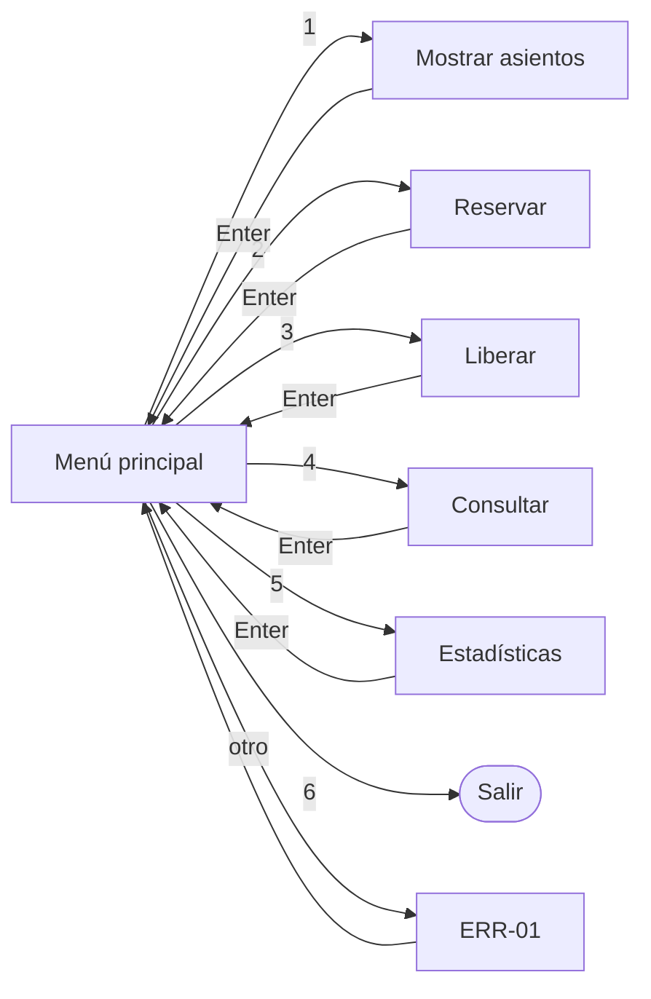

# Día 3 – Actividad 2: Mensajes y flujo de navegación

**Proyecto Integrador: Sistema de administración de asientos de cine**

**Responsable:** Carlos Damián Nava Solís

---

## 1. Reglas de entrada de datos

| Dato | Formato esperado | Qué se acepta | Qué se rechaza |
|---|---|---|---|
| Opción del menú | Número entero 1 a 6 | `1`…`6` | Letras, vacío, 0, 7 o más |
| Fila | Una letra A a E | `A`…`E` (mayúscula o minúscula) | Otras letras, números, vacío |
| Columna | Número entero 1 a 8 | `1`…`8` | Letras, 0, 9 o más, vacío |

Conversión interna: la letra de fila se convierte a índice (A=0, B=1, … E=4) y la columna se convierte restando 1 (1→0, … 8→7), para acceder a `sala[fila][columna]`.

---

## 2. Catálogo de mensajes

### Confirmación

| Código | Mensaje |
|---|---|
| OK-01 | `Reservación exitosa: asiento {fila}{columna} ocupado.` |
| OK-02 | `Asiento {fila}{columna} liberado correctamente.` |
| OK-03 | `El asiento {fila}{columna} está DISPONIBLE.` |
| OK-04 | `El asiento {fila}{columna} está OCUPADO.` |

### Error y validación

| Código | Situación | Mensaje |
|---|---|---|
| ERR-01 | Opción del menú inválida | `Opción inválida. Elija un número del 1 al 6.` |
| ERR-02 | Fila fuera de rango o no es letra | `Fila inválida. Use una letra de la A a la E.` |
| ERR-03 | Columna fuera de rango o no es número | `Columna inválida. Use un número del 1 al 8.` |
| ERR-04 | Reservar asiento ocupado | `El asiento {fila}{columna} ya está ocupado. Elija otro.` |
| ERR-05 | Liberar asiento libre | `El asiento {fila}{columna} ya estaba libre. No había reservación.` |
| ERR-06 | Entrada vacía | `No ingresó ningún dato. Intente de nuevo.` |

Todos los mensajes de error regresan al menú principal sin cerrar el programa.

---

## 3. Flujo de navegación

---

## 4. Comportamiento común de las pantallas

- Cada operación muestra un encabezado con su nombre.
- Después de cada resultado, el sistema espera Enter y regresa al menú.
- El menú se muestra en ciclo hasta que el usuario elige **6**.
- Antes de reservar o liberar, conviene mostrar la matriz para que el usuario vea qué asientos hay (mejora opcional).

---

## 5. Pendientes para el Día 4

- Implementar en código el menú, la matriz y las funciones mostrar, reservar y liberar.
- Usar exactamente los mensajes de este catálogo para que la interfaz coincida con el diseño.