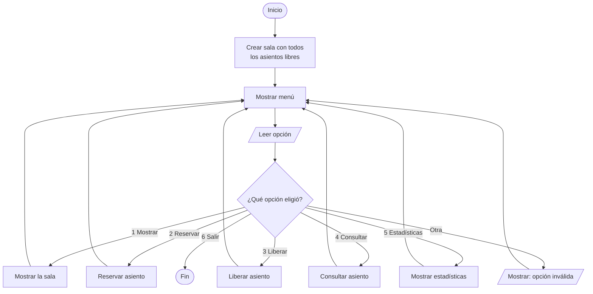
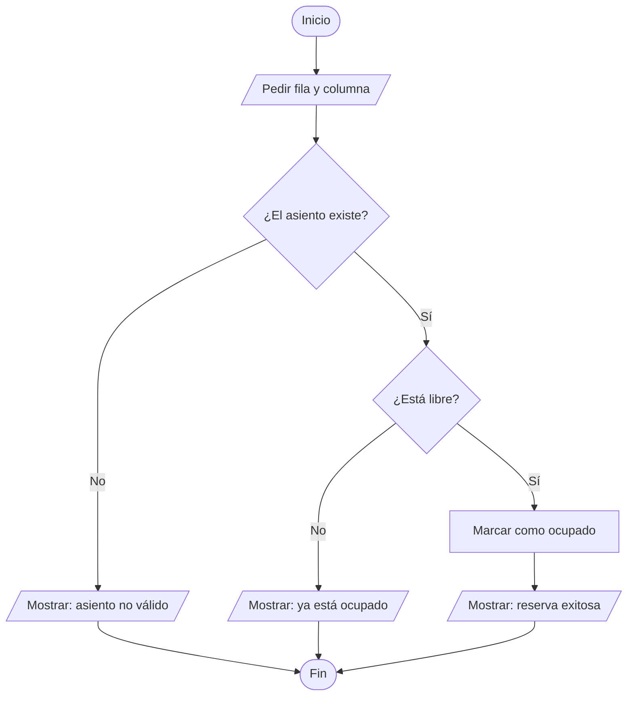
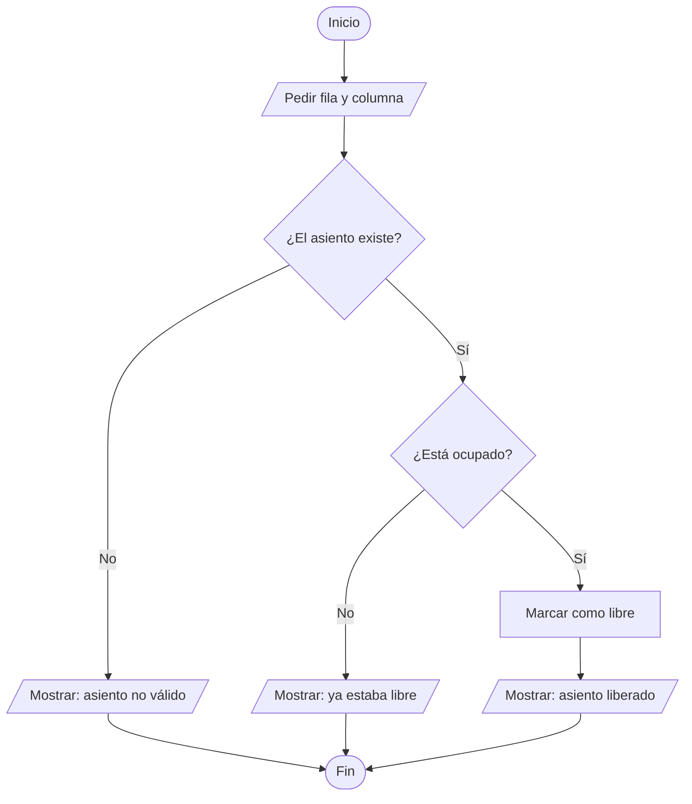
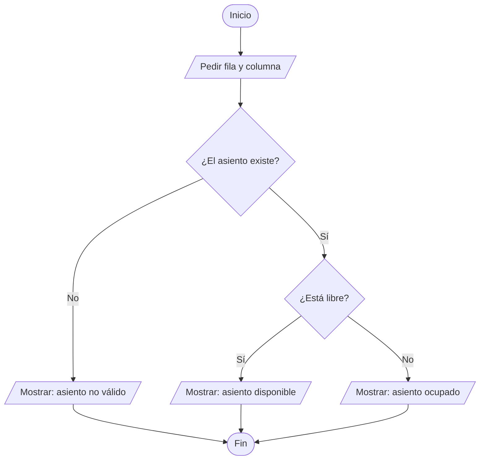
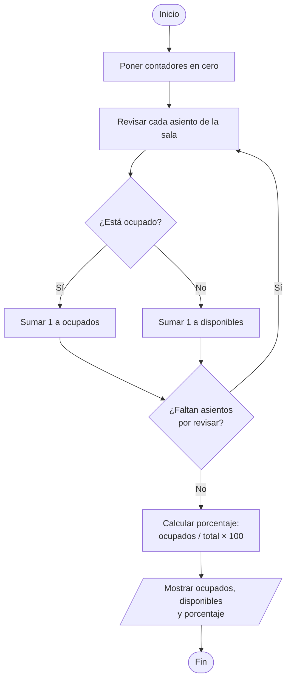

# Día 2 – Actividad 1: Algoritmo general y diagramas de flujo

**Proyecto Integrador: Sistema de administración de asientos de cine**

**Responsable:** Erick Jair Hernández Pacheco

---

## 1. Algoritmo general

1. Inicio del programa.
2. Crear la sala con todos los asientos disponibles.
3. Mostrar el menú: mostrar asientos, reservar, liberar, consultar, estadísticas o salir.
4. El usuario elige una opción.
5. Si la opción no existe, se muestra un error y se regresa al menú.
6. Se realiza la acción elegida:
   - **Mostrar asientos:** se imprime la sala con los lugares libres y ocupados.
   - **Reservar:** se pide fila y columna; si el asiento está libre, se ocupa.
   - **Liberar:** se pide fila y columna; si el asiento está ocupado, se libera.
   - **Consultar:** se pide fila y columna y se indica si está libre u ocupado.
   - **Estadísticas:** se cuentan los asientos ocupados y disponibles y se calcula el porcentaje de ocupación.
7. Se regresa al menú hasta que el usuario elija salir.
8. Fin del programa.

---

## 2. Diagrama de flujo general

---

## 3. Diagrama de flujo: Reservar asiento

---

## 4. Diagrama de flujo: Liberar asiento

---

## 5. Diagrama de flujo: Consultar asiento

---

## 6. Diagrama de flujo: Estadísticas

